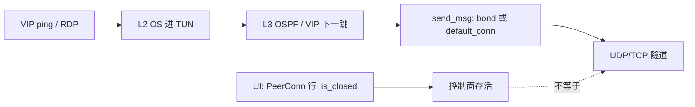

# EasyTier vs Tailscale：延迟 / 卡顿 / 偶发不通 — 代码层审查

## Status

- Status: **Current**（静态审查；**未改代码、未做现网抓包/压测**）
- 最近审阅：2026-10-16（出厂 `mtu`→1300 / TUN 1280；UI 文案/占位与 Go TUN 示例已对齐；其余 P-AUDIT 未改代码）
- 范围：对照 Tailscale（WireGuard 会话保持 + DERP）语义，区分 **代码 bug/冲突** vs **设计默认** vs **运维/环境**
- 关联：[`p2p-direct-stability-audit.md`](./p2p-direct-stability-audit.md)（S1–S5）、[`p2p-direct-throughput-audit.md`](./p2p-direct-throughput-audit.md)（B1–B3）、[`peer-connections.md`](./peer-connections.md)、[`traffic-steering.md`](./traffic-steering.md)
- 修复跟踪：[`../roadmap/connection-stability-todo.md`](../roadmap/connection-stability-todo.md)（P1.5 + 本文新增 P-AUDIT.*）
- 索引：[`../README.md`](../README.md)

> 本文只描述**今天代码做什么**与分类结论。建议修复清单**不是已落地行为**。

---

## 1. 结论摘要

相对 Tailscale，用户感知的「连接慢 / RDP 卡 / 有时 VIP ping 不通」来自三层叠加：

| 层 | 占比（定性） | 本质 |
|----|--------------|------|
| **设计差距** | 主因 | 拆连重建、TCP 回落、静态 MTU、出厂 bond、队列满丢包（S1–S5） |
| **尖锐冲突 / 半 bug** | 加重偶发不通 | 发送缓存跳过质量熔断；`has_peer`≠live conn；无路由/`BufferFull`/入 NIC **静默丢** |
| **运维/环境** | 易误判为产品 bug | 本机代理劫持、Windows 残留 TUN、underlay exclude 不全、L2/L3 策略 |

**一句话**：UI「已连接」= 至少一条 `PeerConn.is_closed == false`；VIP/RDP 还要过 L2→L3→`default_conn`/bond→隧道队列。Tailscale 把这些绑在同一会话上；EasyTier 拆开了，所以状态绿仍可能业务黑。



---

## 2. UI「已连接」含义（已核实）

| 信号 | 位置 | 含义 | 不保证 |
|------|------|------|--------|
| `PeerConnInfo.is_closed == false` | `peer_conn.rs` ~1549；`list_peer_conns` 过滤已关 | 隧道对象未关 | 该 conn 是 `default_conn` / bond 成员；`loss_rate` 低 |
| `quality_score` / `quality_fused` | `peer.rs` `list_peer_conns` ~411–445 | 状态面解释选路 | 发送快路径**不**每包重算 |
| `PeerMap.has_peer` | `peer_map.rs:148-150` | map 里有 `Peer` 条目 | `has_live_conns()`（对比 `list_peers_with_conn` :366-373） |
| `send_msg_by_ip` 成功 `Ok` | `peer_manager.rs:3328-3330` | 可能是**故意丢包后返回 Ok** | 包已进对端 |

因此：**状态页绿 ≠ VIP 可达** —— 这是产品语义，不是显示 bug；但若干静默丢路径会让排障极难（§3）。

---

## 3. Bug / 尖锐冲突（代码证据）

### C1 — `default_conn` 快路径不重验 closed / 质量（P0）

**位置**：`easytier-core/src/peers/conn/peer.rs`

- `send_msg` :301-304：缓存非空则 `conn.send_msg`，**不**查 `is_closed()`、**不**查 `loss_fuse`。
- 缓存清空：:155-161，每 5s 且仅当 `conns.len() > 1`；关连时若指针匹配才清（:104-111）。
- **单连接**时 5s 任务**不清**缓存 → 半死路径可长期扛业务，直到 ping 累满关连（S1）。

**症状**：UI 仍显示该 peer 已连（甚至另有更好链路行）；RDP/ping 走 incumbent 高丢包路径 → 卡顿或间歇失败。  
**对照 Tailscale**：无「多 conn 缓存 + 质量迟滞」这一层。  
**分类**：**尖锐冲突**（质量选路 P1.7 只在 `select_conn` 重建时生效，与热路径缓存打架）。

### C2 — bond 缓存只验 `!is_closed()`，质量只在重建时生效（P0）

**位置**：同文件 `select_bond_conns` :317-323；重建时 `pick_bond_set` 会排除 fused（`conn_bond.rs` 测例 `fused_excluded_when_alternative_exists`）。

- 出厂 `peer_link_bond_count=2`（`toml.rs:171`）→ 默认走 bond 分支（:281-297）。
- 缓存命中条件：**成员均未 closed**；成员从「好」劣化到「fused」后，**最多拖到下次 5s 清缓存或 send 失败**（:294-296 `inspect_err` 清缓存）。
- 流哈希粘到坏成员 → 同 peer 下 **部分流通、部分不通**（含 VIP ICMP vs RDP 五元组不同）。

**症状**：两条链路 UI 都绿；偶发 ping 不通或单侧 RDP 极慢。  
**分类**：**尖锐冲突** + 与稳定性文档 S4 同根；缓存窗口是额外加重因素。

### C3 — `has_peer(gateway)` ≠ 可用下一跳（P1）

**位置**：

- `has_peer`：`peer_map.rs:148-150`（仅 `contains_key`）。
- `get_gateway_peer_id`：:202-204，LeastHop 且 `has_peer(dst)` 时**直接返回 dst**（即使无 live conn 的语义取决于 Peer 是否仍在 map）。
- `send_msg_internal`：`peer_manager.rs:3925-3944`，网关可达判定用 `peers.has_peer(gateway) || foreign_network_client.has_next_hop(gateway)`；否则 warn `"cannot send msg to peer through gateway"` → `RouteError`。

对比：`list_peers_with_conn`（:366-373）才过滤 `has_live_conns()`。

**症状**：拓扑/UI 仍有其它直连行「已连」；到某 VIP 需经网关时数据面失败。  
**分类**：**半 bug**（API 语义过宽）；应改为 live conn / `send_msg_directly` 前校验。

### C4 — 无下一跳时 `Ok(())` 静默丢（P0 可观测）

**位置**：`peer_manager.rs` `send_msg_by_ip` :3328-3330：

```text
if dst_peers.is_empty() {
    tracing::info!("no peer id for ip: {}", ip_addr);
    return Ok(());
}
```

另：policy `RouteLookup::Block` :3219-3225 同样返回空 `dst_peers`（设计为防泄漏，但同样无计数器）。

**症状**：VIP ping 不通；控制面 PeerConn 仍绿；上层无错误。  
**分类**：**可观测性缺陷**（丢包本身在 Block 场景是设计；VIP 未进表时的 Ok 易误导）。

### C5 — 入 NIC / 发送环静默或难观测丢（P0 可观测 / P2 背压）

| 点 | 位置 | 行为 |
|----|------|------|
| 入 NIC | `peer_manager.rs` `NicPacketProcessor` :745-752 | `try_send` 失败 → `trace!` 丢包 |
| UDP 出站 | `tunnel/udp.rs:124-126` `force_send`；容量 `socket/ring.rs:12` **128**（预留 4） | `Full` → `TunnelError::BufferFull` |
| 中继握手缓冲 | `relay_peer_map.rs:264-269` | 满则注释「silently drop」 |

**症状**：小包 ICMP 常通、RDP 突发卡顿（与吞吐文档 B2 / 稳定性 S5 一致）。  
**分类**：满则丢是**设计**；缺计数/状态面是**缺陷**；相对 Tailscale 体感更差。

### C6 — LeastHop「有 Peer 条目即当直连」（P1，与 C3 相关）

**位置**：`get_gateway_peer_id` :202-204。

若 Peer 仍在 map 但无可用 conn，LeastHop 仍选 dst 为 gateway，后续 `send_msg_directly` / `peer.send_msg` 失败路径依赖 C3。多跳 VIP 在「以为直连」时更容易黑。

---

## 4. 设计差距（非 bug；解释 vs Tailscale）

与 [`p2p-direct-stability-audit.md`](./p2p-direct-stability-audit.md) S1–S5 对齐，此处只列对照，不重复长文。

| ID | EasyTier 默认 | 代码锚点 | Tailscale/WG 对照 | 用户症状 |
|----|---------------|----------|-------------------|----------|
| S1 | 连续 ping 失败 **5** 次拆 PeerConn | `peer_conn_ping.rs:327-336`；`toml.rs:159` | 会话保持，短暂丢包后续传 | 闪断后 RDP 冻结数秒（重握手） |
| S2 | `default_protocol = "udp,tcp"` | `toml.rs:114`；`protocol_preference.rs` | DERP 非裸 TCP 隧道叠 TCP | UDP 被阻 → TCP-over-TCP → 卡死 |
| S3 | flags.mtu **1300**，加密后 TUN **1280**（2026-10-16 前为 1380→1360） | `toml.rs` / `virtual_nic.rs:735-742` | TUN **1280**（已核实） | 出厂已对齐；极端路径仍可再调低 |
| S4 | `peer_link_bond_count=2` 流哈希 | `toml.rs:171`；`peer.rs` bond | 单会话 | 换成员乱序/粘坏链 |
| S5 | 环深 128，满则丢 | `ring.rs` / `udp.rs` | 背压更常见 | 突发卡顿 |

另：KCP/QUIC proxy **默认关**（`toml.rs:135,141`）——弱网无自动抗丢包产品化（Roadmap P2.5）。

---

## 5. 默认组合冲突矩阵

| # | 组合 | 触发 | 可见症状 | 应改语义？ |
|---|------|------|----------|------------|
| X1 | `bond_count=2` + 质量迟滞（~15s）+ 5s 缓存 | 一成员丢包升高但未 closed | 同 peer 下流级间歇失败；UI 双绿 | **是**（C1/C2：热路径尊重 fuse） |
| X2 | `udp,tcp` + RDP/SSH | UDP 限速/阻断回落 TCP | 「有时很卡」；状态显示 tcp | 配置可缓；**UI 强提示**或交互场景默认勿回落 tcp |
| X3 | S1 拆连 + 无抖动宽限（P1.5 未做） | 短暂丢包 | 比 Tailscale 更易整段冻结 | Roadmap P1.5 |
| X4 | `p2p_only` / `disable_relay_data` + 需多跳 VIP | 无直连到目标 | UI 有其它 peer 绿；目标 VIP 不通 | **否**（政策）；须文档/UI 标明 |
| X5 | L3 policy `closed` + L2 仍可能装过路由 | 候选全不可用 | ping 丢、无错；peer 仍绿 | Block 是设计；需可观测（C4） |
| X6 | TUN `/0` + underlay exclude 不全 | 出站被本机代理/错误 nic 劫持 | 相对 Tailscale「同网更差」 | 环境；见稳定性审计 §5 步骤 1 |
| X7 | Windows 残留 `et_*` | 异常退出未清 | VIP 进死接口；core 仍报 PeerConn | 运维；见 `traffic-steering` |

---

## 6. 运维 / 环境（勿当成 core bug）

1. **本机透明代理**放行 Tailscale 未放行 EasyTier → underlay 不同（稳定性审计已标推断）。
2. **Windows wintun / 路由残留**。
3. **出口 `/0` 与物理默认路由 metric 战争**（Roadmap default-route Phase 2）。
4. 状态页 **2s** 轮询：短暂黑洞可能未截获。

---

## 7. 配置层临时缓解（不改代码）

沿用 [`p2p-direct-stability-audit.md`](./p2p-direct-stability-audit.md) §5，对照本审查优先序：

| 优先 | 项 | 建议 | 对准 |
|------|-----|------|------|
| 0 | 排除代理/路由混杂 | `easytier-cli peer` 看 scheme/RTT/loss | X6 |
| 1 | `peer_link_bond_count` | **1**（对照） | C2 / S4 / X1 |
| 2 | `mtu` | 出厂已 **1300**；老配置仍 1380 时改掉或重建 | S3 |
| 3 | `ping_fail_close_count` | **10** | S1 / X3 |
| 4 | `default_protocol` | 确认 UDP 可用时用 **`udp`** | S2 / X2 |

---

## 8. 建议修复清单（**未实现**；需二次确认再改代码）

### P0

| ID | 项 | 建议改法 | 验收 |
|----|-----|----------|------|
| P-AUDIT.1 | 热路径尊重 closed + fuse | `send_msg` / bond 缓存命中时：closed 或 `loss_rate > fuse`（且有替代）→ 清缓存并 `select_*` | 高丢包 incumbent 在 1 个探测窗口内不再扛业务 |
| P-AUDIT.2 | 空 `dst_peers` / Block 可观测 | 计数器 + 不低于 `warn`（或状态面「无下一跳丢包」） | 复现 VIP 无路由时能量化 |
| P-AUDIT.3 | `BufferFull` / NIC `try_send` 失败可观测 | 计数暴露到 metrics/CLI | RDP 突发时可对上丢包 |

### P1

| ID | 项 | 建议改法 | 跟踪 |
|----|-----|----------|------|
| P-AUDIT.4 | `has_peer` 用于转发前改为 live | `send_msg_internal` / gateway 判定用 `has_live_conns` 或试发失败快切 | 本文 C3/C6 |
| P1.5 | 短时抖动宽限 | 短暂丢包不立即拆 conn | 已有 Roadmap |
| P-AUDIT.5 | TCP 回落产品提示 | 状态面 scheme=tcp 时警告「交互式易卡」；或文档默认建议 | X2 |

### P2

| ID | 项 | 说明 |
|----|-----|------|
| P-AUDIT.6 | 队列背压 | 满时等待/降速，而非仅丢（吞吐 B2） |
| S3/PMTU | MTU 自适应或 MSS 钳制 | 稳定性审计 §6 |
| P2.5 | KCP/QUIC 弱网产品化 | 既有 Roadmap |

---

## 9. 局限

1. 静态读代码 + 常量核实；**未**现网 A/B Tailscale、未抓包确认路径 MTU / 代理劫持。
2. 未覆盖 Android VPN 生命周期（见 Archive 安卓审计）。
3. QUIC/WG/faketcp 直连细节未逐 scheme 复查。

---

## 10. Changelog

| 日期 | 变更 |
|------|------|
| 2026-10-16 | 首版：C1–C6 + S1–S5 分栏 + 冲突矩阵 + P-AUDIT 修复清单 |
| 2026-10-16 | 出厂 `flags.mtu` 1380→**1300**；Config UI 中/英帮助与占位；安卓 `resolveVpnMtu` 回退；Go TUN 示例 MTU **1280** |
