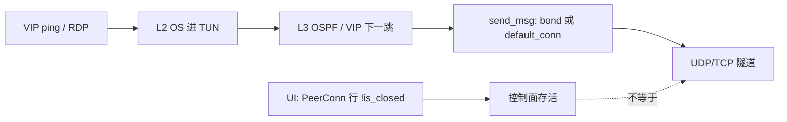

# EasyTier vs Tailscale：延迟 / 卡顿 / 偶发不通 — 代码层审查

## Status

- Status: **Current**（静态审查 + 2026-10-17 一轮代码修复；**仍无现网抓包/压测**）
- 最近审阅：2026-10-17 v2 **勘误**（§8 P1 删过时的 `P-AUDIT.8` 旧条目、§1.2 删重复行、§5.1 补记 P-AUDIT.7 已落地、§11 修正「easytier crate 无法构建」）；同日首版（**P-AUDIT.1/2/3/4/9/10 + S1b + `latency_first` 默认统一 + KCP 对齐 已合入、待现网验收**；新增 §5.1「不通 vs 卡顿」分栏与失效链、§9 设计原则三轴、§10 默认值一致性；**并推翻两条初版结论**：§3 C7「状态页绿一小时」、§5.1「纯 P2P 无中继」）
- 范围：对照 Tailscale（WireGuard 会话保持 + DERP）语义，区分 **代码 bug/冲突** vs **设计默认** vs **运维/环境**
- 关联：[`p2p-direct-stability-audit.md`](./p2p-direct-stability-audit.md)（S1–S5/S1b）、[`p2p-direct-throughput-audit.md`](./p2p-direct-throughput-audit.md)（B1–B3）、[`peer-connections.md`](./peer-connections.md)、[`traffic-steering.md`](./traffic-steering.md)
- 修复跟踪：[`../roadmap/connection-stability-todo.md`](../roadmap/connection-stability-todo.md)（P1.5 + 本文 P-AUDIT.*）
- 索引：[`../README.md`](../README.md)

> 本文只描述**今天代码做什么**与分类结论。建议修复清单**不是已落地行为**。

---

## 1. 结论摘要

相对 Tailscale，用户感知的「连接慢 / RDP 卡 / 有时 VIP ping 不通」来自三层叠加：

| 层 | 占比（定性） | 本质 |
|----|--------------|------|
| **设计差距** | 主因 | 拆连重建、TCP 回落、静态 MTU、出厂 bond、队列满丢包（S1–S5） |
| **尖锐冲突 / 半 bug** | 加重偶发不通 | 发送缓存跳过质量熔断；`has_peer`≠live conn；无路由/`BufferFull`/入 NIC **静默丢** |
| **运维/环境** | 易误判为产品 bug | 本机代理劫持、Windows 残留 TUN、underlay exclude 不全、L2/L3 策略 |

**一句话**：UI「已连接」= 至少一条 `PeerConn.is_closed == false`；VIP/RDP 还要过 L2→L3→`default_conn`/bond→隧道队列。Tailscale 把这些绑在同一会话上；EasyTier 拆开了，所以状态绿仍可能业务黑。



### 1.1 2026-10-17 一轮修复的落地清单（**代码已合入，全部待现网验收**）

| ID | 一句话 | 类别 |
|----|--------|------|
| P-AUDIT.1 | 热路径 `default_conn`/bond 缓存尊重 closed + loss fuse；fused incumbent 暴露窗口 ≈20s → 0 | bugfix |
| P-AUDIT.2 | 空 `dst_peers` 丢包计数 `data_plane_no_dst_peer_drops` | 可观测性 |
| P-AUDIT.3 | NIC 满 / 隧道环满计数（含**中继转发腿**） | 可观测性 |
| P-AUDIT.4 | `has_peer_with_live_conn` 闸门；**坏直连不再堵死中继兜底** | **行为变更** |
| S1b | UDP 打洞 conn 保活上限 32s → **10s** | bugfix |
| DEF | `latency_first` core/GUI 默认统一为 `true`（质量优先） | **行为变更** |
| P-AUDIT.9 | Bond 成员改**一致哈希**；纯重排导致 0 流迁移（原按位置哈希会重排） | bugfix |
| P-AUDIT.10 | `AVOID_RELAY_COST` 有限化 + `path_latency` 如实上报 + Web 渲染「政策绕行」 | **行为变更**（状态面数值） |
| KCP | GUI `enable_kcp_proxy` 由 `true` 对齐 core `false`（「KCP 模式不开启」） | **行为变更**（新建 GUI 配置） |
| P-AUDIT.5 | 状态页协议列在**所有隧道均为自带重传传输**时给出 ⚠ + 说明（TCP-over-TCP 提示） | 可观测性 |
| P-AUDIT.7 | `ping_fail_close_count` 默认 **5 → 10**；顺带修掉 `peer_conn.rs` 里硬编码的 `5` 回落值（与 `gen_default_flags` 会漂移） | **行为变更** |

> **行为变更需要 release note**：`latency_first`（既有未显式配置的 TOML/CLI 部署升级后跨 peer 选路可能改走中继）、P-AUDIT.4（坏直连改走中继而非直接失败）、P-AUDIT.10（`path_latency` 不再抹掉政策惩罚，数值会变大）、KCP 默认关闭、`ping_fail_close_count` 5→10（拆连判定从 ~15s 放宽到 ~30s）。
> **`cargo test -p easytier-core --lib` 964 passed / 0 failed**（本轮 P-AUDIT 口径；全仓 CR 轮合入后同口径 **986**、叠加 `proxy-smoltcp-stack` **1150**，见 [`../roadmap/code-review-fixes-2026-10.md`](../roadmap/code-review-fixes-2026-10.md) §6）；Web `vitest` 192 passed；clippy 无新增告警（P-AUDIT.9 遗留的 `bond_member_for_flow is never used` 已于 CR 轮加 `#[cfg(test)]` 门控消除）。四份文档（本文 / `peer-connections.md` / `p2p-direct-stability-audit.md` / Roadmap）已同步。

### 1.2 仍未解决（按用户原则的重要性排序）

| 优先级 | ID | 为什么重要 |
|---|---|---|
| P2 | **P-AUDIT.10b** / **8b** | proto 缺「中间跳拒载」「最近可达」字段，状态面只能看出「被绕行」「有路由」，看不出细节 |
| P2 | P-AUDIT.6 队列背压 | 满则丢是设计，但突发下内层 TCP 误判拥塞。**本轮明确不做**（见 §11） |
| P2 | PMTU / MSS 钳制 | 出厂 1280 已对齐，极端嵌套仍可能超。**本轮不做**（见 §11） |
| P2 | P1.5 抖动宽限 | 拆连阈值已放宽到 10；「仅在无替代路径时才激进拆」的正确形态仍需改（见 §8 P1） |
| — | ~~P-AUDIT.8 收紧过期策略~~ | **已推翻**：实测收敛在 ~1s，见 §3 C7。收紧反而有 flapping 风险 |

---

## 2. UI「已连接」含义（已核实）

| 信号 | 位置 | 含义 | 不保证 |
|------|------|------|--------|
| `PeerConnInfo.is_closed == false` | `peer_conn.rs` ~1549；`list_peer_conns` 过滤已关 | 隧道对象未关 | 该 conn 是 `default_conn` / bond 成员；`loss_rate` 低 |
| `quality_score` / `quality_fused` | `peer.rs` `list_peer_conns` ~411–445 | 状态面解释选路 | 发送快路径**不**每包重算 |
| `PeerMap.has_peer` | `peer_map.rs:148-150` | map 里有 `Peer` 条目 | `has_live_conns()`（对比 `list_peers_with_conn` :366-373） |
| `send_msg_by_ip` 成功 `Ok` | `peer_manager.rs:3328-3330` | 可能是**故意丢包后返回 Ok** | 包已进对端 |

因此：**状态页绿 ≠ VIP 可达** —— 这是产品语义，不是显示 bug；但若干静默丢路径会让排障极难（§3）。

---

## 3. Bug / 尖锐冲突（代码证据）

> 每条给出：**机制**（为什么会坏）→ **改前/改后行为** → **影响面**（是 bugfix 还是行为变更）→ **单测锚点**。

### C1 — `default_conn` 快路径不重验 closed / 质量（✅ 已修 = P-AUDIT.1）

**位置**：`easytier-core/src/peers/conn/peer.rs` `Peer::send_msg` / `select_conn`

**机制（三段叠加，所以窗口比「5s」大得多）**

1. 缓存命中即直接 `conn.send_msg`，**不查 `is_closed()`、不查 `loss_fuse`**。
2. 主动清缓存有两条路，都不够快：
   - 定时任务 `default_conn_clear_task`：每 **5s**，且**仅当 `conns.len() > 1`** 才 `store(None)`；
   - 关连事件监听：仅当被关的 conn **指针匹配**缓存时才清。
3. 即使缓存清了，`select_conn` → `pick_default_conn` 还有**质量迟滞**：`switch_windows = 3`，需连续 3 个窗口（≈15s）更优才切。

⇒ **一条已 fused 的 incumbent 最坏可承载 ≈ 5s（缓存）+ ≈ 15s（迟滞）≈ 20s 的业务**。

**单连接场景为什么不需要修**：`conns.len() == 1` 时定时任务不清缓存，看似是洞；但此时 `has_unfused_alternative` 恒为 `false`，新逻辑按设计**仍返回 false**（唯一路径即使 fused 也继续发）。**这是刻意的 no-op，不是漏网** —— 避免无替代路径时反复拆了又建（抖动）。此语义由 `cached_path_unusable` 的 `has_unfused_alternative` 参数表达。

**改前 / 改后**

| | 改前 | 改后 |
|---|---|---|
| cached conn 已 closed | 继续发（靠指针匹配兜底，多数情况能清） | `is_closed()` 立即失效并重选 |
| cached conn fused 且有**已验证未熔断**替代 | 继续发 ≤20s | 立即失效重选（`incumbent_unusable` 分支本就绕过迟滞） |
| cached conn fused 但**唯一**路径 | 继续发 | **继续发**（设计如此，不抖动） |
| 每包开销 | `ArcSwap::load` + send | 同 + 一次 conn 扫描（纯原子读，见下） |

**一致性要点**：判定必须用 `is_unfused_verified`（`!unverified_hole_punch && !fused`），与 `pick_default_conn`、`pick_bond_set` 内部的 `has_unfused` **逐字一致**。若只用 `!fused`，会在「唯一替代是未验证打洞」时错误清缓存。

**性能**：新增的每包 `conn_select_metrics` 扫描只做原子读（jitter 走 15 元素窗口，`bond_count=2` 时 ≈46 次 relaxed 原子读 ≈46ns，50k pps 下 ≈0.23% 单核）。早期版本每包还会 `context.flags()` 深拷贝 `FlagsInConfig`（50+ 字段、约 5 次堆分配），已改为 `PeerContext::{bond_config, conn_select_config}` 借快照，**零分配**。

**影响面**：纯 bugfix，不改变选路语义（只让既有规则更早生效）。

**单测**：`conn_select::tests::cached_path_unusable_closed_or_fused_with_alternative`、`is_unfused_verified_matches_selector_alternative_rule`。

### C2 — bond 缓存只验 `!is_closed()`，质量只在重建时生效（✅ 已修 = P-AUDIT.1 缓存侧 + P-AUDIT.9 选流侧）

**原缺陷（两个独立层面，都已修）**

**(a) 缓存不校验质量** —— `select_bond_conns` 命中缓存的条件只有「成员均未 closed」；成员从「好」劣化到 fused 后，最多要拖到下次 5s 清缓存或 `inspect_err` 失败才重建。

- 出厂 `peer_link_bond_count=2`（`toml.rs:171`）→ **默认就走 bond 分支**。
- **已修**：与 `default_conn` 共用 `cached_path_unusable` + `is_unfused_verified`，且判定为**每包**执行而非等 5s。

**(b) 流按位置哈希钉成员（这才是「部分流通、部分不通」的根因）** —— `bond_member_index(key, member_count) = key % member_count` 读的是成员的**位置**，而 `pick_bond_set` 在质量档变化时会**重排**成员（`cmp_candidate_score_then_id`）→ 同一流的哈希目标换到另一条 conn。

- 症状：VIP ICMP 与 RDP 五元组不同 → 分到不同成员 → **一条通一条不通**；换路瞬间两条独立 UDP 路径的时延差造成乱序 → RDP 视作丢包。
- **已修（P-AUDIT.9）**：改为**一致哈希**（对每个成员的 `conn_id` 求哈希取最小）—— 纯重排导致 **0 个流迁移**，且**绝不会**把流指向**已在集合里的另一个成员**。
- ⚠️ **刻意不强制选最优成员**：bonding 的价值是聚合吞吐；压成「永远走最优」等于删能力（与把 `bond_count` 降回 1 同类错误）。质量仍通过 `pick_bond_set` 决定**成员资格**。

**分类**：**尖锐冲突**；与稳定性文档 S4 同根。

### C3 — 已死的 Peer 条目堵死中继兜底（✅ 已修 = P-AUDIT.4；初版只看到一半）

**初版误判**：初版只记了「网关闸门用 `has_peer` 太宽」，**漏了更严重的一半** —— 直连分支本身也没有 live conn 检查，而它排在 relay 分支**前面**。

**机制（改前 `send_msg_internal` 的分支顺序）**

```text
① latency_first && gateway≠dst && has_peer(gateway)      → relay     ← 闸门只查 contains_key
② get_peer_by_id(dst)                                    → 直连     ← 同样不查 live conn ★
③ is_self(dst)                                           → 自发
④ foreign_network_client.has_next_hop(dst)               → 跨网
⑤ get_gateway_peer_id(dst) && has_peer(gateway)          → relay     ← 同样只查 contains_key
```

`has_peer` 的问题：`peer_map.contains_key(&peer_id)`。而 Peer 条目由**关连事件监听**异步清理，**最后一条 conn 断开后条目仍在一段时间内存在**。

★ 于是：直连 conn 已死 → `get_peer_by_id(dst)` 仍返回它 → **分支 ② 命中** → `Peer::send_msg` → `select_conn()` 返回 `None` → `PeerNoConnectionError` → **函数直接返回，永远走不到分支 ⑤ 的中继腿**。

同理，分支 ①/⑤ 的闸门放行一个已死网关后，中继内部同样会失败（`RelayPeerMap` → `send_msg_to_next_hop` → `send_msg_directly` → `Peer::send_msg` → `PeerNoConnectionError`）。

**这正是「中继本该救你，却没救成」的最坏形态**，也是 §5.1 里「不通」链的关键一环。

**改法（保持边界克制）**

| 判断 | 改前 | 改后 |
|---|---|---|
| 「能不能交给它」（发送前可用性） | `has_peer` / 无检查 | **`has_peer_with_live_conn`**（`my_peer_id` 或 `has_live_conns()`） |
| 「下一跳是谁」（选路/拓扑） | `has_peer` | **保持 `has_peer`** |

**为什么不把 `get_gateway_peer_id` 也改掉**：它回答的是拓扑问题（「按 OSPF，下一跳应该是谁」），不是可用性问题。把它改成 live conn 会**改变路由决策本身**（可能选到不同的中继），属于行为变更而非可用性修复。两者必须分开 —— 这条边界已写进 `PeerMap::has_peer_with_live_conn` 的 doc comment 与 [`peer-connections.md`](./peer-connections.md)。

对比参考：`list_peers_with_conn`（`peer_map.rs:366-373`）本来就用 `has_live_conns()` 过滤；问题是转发决策没用它。

**影响面**：**这是行为变更**。改后「直连条目还在但 conn 已死」的目标会**改走中继**而不是直接失败。对直连更近的用户可能多一跳 —— 但那是质量选路该做的判断，比直接丢包好。

**单测**：`peers::tests::has_peer_with_live_conn_tracks_conn_liveness_not_map_presence` —— 核心断言是 `has_peer(2)` 与 `has_peer_with_live_conn(2)` **在关连后分叉**（前者仍 true、后者 false）。

### C4 — 无下一跳时 `Ok(())` 静默丢（✅ 已修 = P-AUDIT.2）

**位置**：`peer_manager.rs` `send_msg_by_ip` 的 `dst_peers.is_empty()` 分支。

**改前**：仅一条 `tracing::info!`，无计数器。上层拿到 `Ok(())`，无法区分「已发出」与「故意丢弃」。

另：policy `RouteLookup::Block` 返回空 `dst_peers`（**丢包本身是设计**，防泄漏到物理网关），但同样无计数器。

**改后**：`no_dst_peer_drops` 计数器 +1（`data_plane_no_dst_peer_drops`，标签 `network_name`），日志降为 `debug`。

> **为什么是 `debug` 不是 `warn`**：这条路径**每包**触发，`warn!` 会在丢包时把日志打爆。**以计数器为可观测信号**。若确需 `warn` 语义，按同文件 `take_path_unavailable_warn_token()` 的令牌限流范式改。
> **policy Block 复用同一计数器**：它返回空集，自然落到 `dst_peers.is_empty()` 这条路径上，不重复计数。

### C5 — 入 NIC / 发送环静默或难观测丢（✅ 已修 = P-AUDIT.3；背压部分见 P2）

| 点 | 位置 | 改前 | 改后 |
|----|------|------|------|
| 入 NIC | `NicPacketProcessor::try_process_packet_from_peer` | `trace!` 丢包 | `data_plane_nic_channel_drops` + `debug` |
| UDP 出站环满 | `tunnel/udp.rs` `force_send`；容量 `socket/ring.rs` **128**（预留 4） | `TunnelError::BufferFull` 上抛，无统计 | `data_plane_tunnel_buffer_full` + `debug` |
| 中继转发腿 BufferFull | `PeerPacketRouter::handle_packet` | 无统计 | **同计数器**（初版遗漏，中继节点恰恰最需要） |

**症状**：小包 ICMP 常通、RDP 突发卡顿（与吞吐文档 B2 / 稳定性 S5 一致）。

**分类**：满则丢是**设计**；缺计数/状态面才是**缺陷**。

**覆盖范围**：`note_tunnel_buffer_full()` 必须在**全部 4 处** `send_msg_internal` 调用点执行（`send_msg_by_ip` 的 fanout 分支 / 指定 peer 分支、中继转发分支）。漏掉任一处，对应拓扑就不可观测。

### C6 — LeastHop「有 Peer 条目即当直连」（P1，与 C3 相关）

**位置**：`get_gateway_peer_id` :202-204。

若 Peer 仍在 map 但无可用 conn，LeastHop 仍选 dst 为 gateway，后续 `send_msg_directly` / `peer.send_msg` 失败路径依赖 C3。多跳 VIP 在「以为直连」时更容易黑。

> **2026-10-17 的处置**：该短路**保持不变**（它回答的是拓扑问题）。它的实际后果 —— 一条已死的直连**堵死中继兜底** —— 已由 **C3 / P-AUDIT.4** 在**发送前可用性闸门**上解决；且 `latency_first` 默认改为 `true` 后，最短跳短路对绝大多数目标**不再生效**（LeastCost 下 `get_gateway_peer_id` 会走路由表，允许中继腿按代价胜出）。

### C7 — 「状态页长时间显示已连接」：**初版判断错误，实测后推翻（不改代码）**

**初版说法（错）**：「peer 信息在 `REMOVE_UNREACHABLE_PEER_INFO_AFTER = 90s` / `REMOVE_DEAD_PEER_INFO_AFTER = 3660s` 下才清理，所以对端掉线后状态页最长可绿**一小时**。」

**错在哪**：`REMOVE_*` 这两个常量管的是 **peer_info 记录（hostname / IPv4 / feature flag）的垃圾回收**，**不是状态页那一行的去留**。状态页的行由 `list_routes` 产出，而它有一道更早的闸门：

```rust
// peer_ospf_route.rs::list_routes
let Some(next_hop_peer) = self.get_next_hop(*item.key()) else {
    continue;                       // ← 没有下一跳 ⇒ 这一行直接不出现
};
```

**真实链路（逐环追踪）**

| 环 | 机制 | 代码锚点 | 耗时 |
|---|------|----------|------|
| ① | 对端 conn 全部断开后，邻居**立刻**不再通告它 —— `RouteInterface::list_peers()` 只收 `peer_map.list_peers_with_conn()`，后者按 `has_live_conns()` 过滤 | `peer_manager.rs` `PeerManagerRouteInterface::list_peers`；`peer_map.rs::list_peers_with_conn` | 即时 |
| ② | 邻居下一次 route sync 后，本机 `conn_map[邻居]` 不再含它 → 图里少一条边 | `sync_route_info` | ~1s |
| ③ | `gen_next_hop_map_*` 不再为它产出条目 → `get_next_hop` 返回 `None` → **状态页那一行消失** | `list_routes` 的 `continue` | 同一次 rebuild |
| ④ | 陈旧的 `next_hop_map` 条目由 `clean_expired_route_info()` 清理（`retain(v.version >= cur_version)`） | `build_from_snapshot` 末尾 `:675` 调用 | 同一次 rebuild |
| ⑤ | `peer_infos` / `ipv4_peer_id_map` 记录被 GC（`clear_expired_peer`，每 60s 跑、阈值 90s） | `:3482` | 90–150s（**但此时已不影响状态页**） |

⇒ **状态页残留 ≈ 一次 route sync（~1s）量级，不是 90s，也不是 3660s。**

**仍然存在的边角**（已由单测固化）：只要还有邻居**继续声称**与该对端的邻接，它就会带着陈旧数据留在表里 —— 直到那个邻居也把它 prune 掉。单测
`stale_peer_survives_while_a_neighbour_still_claims_adjacency` 先断言「陈旧但仍被声称 → 存活且仍出现在 `list_routes`」，再断言「邻居停止声称 + 版本推进 → 被移除且从 `list_routes` 消失」。

**为什么不去收紧过期策略**：① 正常路径已收敛到 ~1s，收紧没有收益；② 误删一条**其实还能用**的路由会直接打断在途流量（flapping），风险远大于收益；③「有路由」与「最近可达」的状态面区分需要新增 proto 字段 + 跨语言 codegen，改动面大且**无现网环境验收**，记为 P-AUDIT.8b（`cargo check -p easytier` 本身可跑，见 §11）。

> **教训**：本条与 §5.1 的「不是没有中继，是默认不让中继兜底」是同一类错误 —— **只读了常量就下结论，没有把「谁真正门控了用户可见行为」追到底**。凡是影响用户感知的判断，都应先找到**实际门控点**再下结论。

### C8 — 未验证打洞 conn 的 OSPF 边代价空窗（**已复核，暂不改**）

**机制**：`best_edge_cost`（`peer_map.rs`）过滤掉 `unverified_hole_punch`；若某 peer 只有这一条未验证的 conn，它不会写进 `direct_peer_info`，于是 `RouteCostCalculatorImpl::calculate_cost` 落到 `unwrap_or(500)`。

**为何不改（量级复核）**：`ospf_edge_cost_from_score(score) = round(score × 1000)`，默认权重下 ≈ RTT 毫秒量级，`500` ≈ **50ms RTT 等效**。它**不会让路径不可用**，只是让新打通的直连**晚约 1s**（首个 ping 间隔）参与竞争。给未验证 conn 一个「乐观初始代价」的收益 ≈1s，代价是**可能优先一条其实没真打通的路**（此刻 `select_conn` 同样尚未验证它）。**收益不抵风险**，故保留现状并在此记录，避免重复讨论。

**边界确认（避免误判为路由中断）**：OSPF **邻接**来自 `conn_map[src].connected_peers`（`build_peer_graph_from_snapshot`），与边代价**相互独立**。代价缺失只降级为 500，**邻接仍在** → 不会导致「查不到路由」。

---

## 4. 设计差距（非 bug；解释 vs Tailscale）

与 [`p2p-direct-stability-audit.md`](./p2p-direct-stability-audit.md) S1–S5 对齐，此处只列对照，不重复长文。

| ID | EasyTier 默认 | 代码锚点 | Tailscale/WG 对照 | 用户症状 |
|----|---------------|----------|-------------------|----------|
| S1 | 连续 ping 失败 **5** 次拆 PeerConn | `peer_conn_ping.rs:327-336`；`toml.rs:159` | 会话保持，短暂丢包后续传 | 闪断后 RDP 冻结数秒（重握手） |
| S2 | `default_protocol = "udp,tcp"` | `toml.rs:114`；`protocol_preference.rs` | DERP 非裸 TCP 隧道叠 TCP | UDP 被阻 → TCP-over-TCP → 卡死 |
| S3 | flags.mtu **1300**，加密后 TUN **1280**（2026-10-16 前为 1380→1360） | `toml.rs` / `virtual_nic.rs:735-742` | TUN **1280**（已核实） | 出厂已对齐；极端路径仍可再调低 |
| S4 | `peer_link_bond_count=2` 流哈希 | `toml.rs:171`；`peer.rs` bond | 单会话 | 换成员乱序/粘坏链 |
| S5 | 环深 128，满则丢 | `ring.rs` / `udp.rs` | 背压更常见 | 突发卡顿 |
| **S1b** | **UDP 打洞 conn 缺 NAT 保活上限**：自适应 ping 退避到 32s，而 NAT UDP 老化常见 ~30s | **2026-10-17 已修**：UDP 打洞 **10s**（TCP 打洞 1s 不变）；`peer_manager.rs` `hole_punch_ping_max` | WG 靠 rekey + 自身 keepalive 维持映射 | 空闲后最长 ~32s 数据黑洞无人察觉，随后拆连 + 重打洞 |

### S1b 详解 — UDP 打洞缺 NAT 保活上限（✅ 已修）

**机制**：控制 ping 是唯一会刷新 NAT 映射的流量。`PingIntervalController` 自适应退避 `1<<backoff_idx`，`max_backoff_idx = 5` → 上限 **32s**。而 NAT UDP 状态老化常见 **~30s**。

⇒ 一条空闲的 UDP 打洞 conn，**两个 ping 之间就可能跨过老化线**，映射消失。此后发往该 conn 的包被 NAT 丢弃，而 EasyTier **完全不知情** —— 直到下一次 ping 失败、连丢 5 次才拆连重打洞。

**为什么 TCP 打洞早就修过、UDP 反而漏了**：`apply_tcp_hole_punch_ping_policy`（源自 #2632）显式**排除** UDP：

```rust
if conn.tunnel_type().is_some_and(is_udp_hole_punch_tunnel_type) {
    return;                        // UDP 打洞不设 1s 上限
}
conn.set_ping_max_interval(Some(Duration::from_secs(1)));
```

当时的问题是「中间设备掐空闲 **TCP** 流」，UDP 不存在该问题；但**UDP 有 NAT 老化这个不同的问题**，被同一处逻辑顺带忽略了。

**改法**：抽成纯函数 `hole_punch_ping_max(tunnel_type, is_directly_connected)`，按 scheme 选上限。

| conn 类型 | 上限 | 理由 |
|---|---|---|
| 直连（非打洞） | `None` → 沿用全局 32s | 公网可达，无 NAT 保活需求 |
| TCP / FakeTCP 打洞 | **1s** | #2632，中间设备掐空闲 TCP（不变） |
| UDP 打洞 | **10s** | NAT 老化 ~30s，留 3× 余量；代价是每 conn 每 10s 一个 9 字节控制包 |

**为什么不做成可配置**：`PeerConn::max_ping_interval()` 返回 `min(cap, flags_max)`，所以运维显式设置 `ping_interval_max_sec` 时：
- 设得**更严**（如 3s）→ 生效，用户意图保留
- 设得**更松**（如 60s）→ 被收紧到 10s

NAT 保活是**正确性要求**而非调优旋钮，不允许用大值关掉。

**单测**：`udp_hole_punch_gets_nat_safe_ping_ceiling` 把设计意图固化成可执行断言 —— `10s < 32s`（默认值）**且** `10s × 3 ≤ 30s`（老化余量）；另有 `tcp_like_hole_punch_keeps_aggressive_ceiling`、`directly_connected_conns_keep_the_global_default`、`per_conn_cap_never_relaxes_the_operator_setting`。

另：KCP/QUIC proxy **出厂一律不启用**（core `false`，GUI 模板 2026-10-17 由 `true` 对齐为 `false`，见 §11）—— 弱网无自动抗丢包产品化（Roadmap P2.5）。

---

## 5. 默认组合冲突矩阵

| # | 组合 | 触发 | 可见症状 | 应改语义？ |
|---|------|------|----------|------------|
| X1 | `bond_count=2` + 质量迟滞（~15s）+ 5s 缓存 | 一成员丢包升高但未 closed | 同 peer 下流级间歇失败；UI 双绿 | **是**（C1/C2：热路径尊重 fuse） |
| X2 | `udp,tcp` + RDP/SSH | UDP 限速/阻断回落 TCP | 「有时很卡」；状态显示 tcp | 配置可缓；**UI 强提示**或交互场景默认勿回落 tcp |
| X3 | S1 拆连 + 无抖动宽限（P1.5 未做） | 短暂丢包 | 比 Tailscale 更易整段冻结 | Roadmap P1.5 |
| X4 | `p2p_only` / `disable_relay_data` + 需多跳 VIP | 无直连到目标 | UI 有其它 peer 绿；目标 VIP 不通 | **否**（政策）；须文档/UI 标明 |
| X5 | L3 policy `closed` + L2 仍可能装过路由 | 候选全不可用 | ping 丢、无错；peer 仍绿 | Block 是设计；需可观测（C4） |
| X6 | TUN `/0` + underlay exclude 不全 | 出站被本机代理/错误 nic 劫持 | 相对 Tailscale「同网更差」 | 环境；见稳定性审计 §5 步骤 1 |
| X7 | Windows 残留 `et_*` | 异常退出未清 | VIP 进死接口；core 仍报 PeerConn | 运维；见 `traffic-steering` |

---

## 5.1 「不通」与「卡顿」是两条独立的链（**排障时先分清**）

初版把两者混在一起，导致修复清单偏向了「卡顿」。用户报的两个症状需要分开定位：

| | **卡顿 / 劣化** | **不通 / 黑洞** |
|---|---|---|
| 典型症状 | RDP 冻结、卡顿、时延跳变 | ping 不通、完全无流量 |
| 主要机制 | S1–S5、C1/C2：选错路、承载劣化路径太久、丢包放大 | **黑洞期无人察觉** → 检测 → 拆连 → 重建，四段串联 |
| 时间尺度 | 秒～十秒 | **十秒～一分钟**（改前最长 ~2 分钟） |
| 已修 | P-AUDIT.1（缓存侧）、P-AUDIT.9（选流侧）、S1b（部分） | S1b、P-AUDIT.4、P-AUDIT.7（拆连阈值 5 → 10，短暂抖动不再触发拆-建） |
| 关键特征 | 有流量但质量差 | **UI 全程绿**，控制面毫无异常 —— 但这是因为**PeerConn 客观存在**，**不是**路由过期（后者只有 ~1s，见 §3 C7） |

### 「不通」的完整失效链（改前 / 改后）

| 阶段 | 耗时 | 代码依据 | 改后 |
|------|------|----------|------|
| ① NAT 映射老化，包开始黑洞 | — | UDP 层无 keepalive；UDP 打洞 ping 退避到 32s | **10s 上限**（S1b） |
| ② 黑洞开始 → 首次失败 ping | 最长 **32s** | `peer_conn_ping.rs` `PingIntervalController` | **≤10s** |
| ③ 连续失败 → 拆 conn | 改前 5 次 ≈ 10–15s；改后 10 次 ≈ 25–30s（失败后退避重置为 1s，每轮 1s+2s 超时） | `ping_fail_close_count` **5 → 10**（P-AUDIT.7） | **已放宽**：容忍度近乎免费（两种情况重建都要 ~30s） |
| ④ direct task 感知 conn 消失并重投 | ≤5s | `DIRECT_TASK_LOOP_INTERVAL_MS`；main loop 以 `is_finished()` 移除并重投，`backoff_index` **每次调用重置为 0** | 未改（**已复核：重连不走 60s 退避尾段**） |
| ⑤ 取 IP 列表 + 打洞 + 握手 | 2–13s | 打洞 2–6s；握手 5s | 未改 |

**改后最坏窗口**：~10s（②）+ ~30s（③，10 次 × ~3s）+ ~5s（④）+ ~13s（⑤）≈ **45–60s**；改前 ≈ **60–120s**（② 32s + ③ 15s）。

**这期间 UI 显示什么**：**全程「已连接」**。这不是过期策略的问题（见 §3 C7：状态页残留只有 ~1s），而是**①→③ 期间 PeerConn 客观存在且 `is_closed()==false`** —— 控制面无从得知数据面已黑洞。**要缩短这个窗口，只能从「更快发现黑洞」入手**（S1b 已把发现前的等待从 32s 压到 10s），或从「黑洞期不要拆」入手（P1.5 抖动宽限，减少拆-建带来的二次伤害）。

### 关键澄清：不是「没有中继」，而是「默认不让中继兜底」

初版曾据「纯 P2P 组网」推断「无中继」，**该推断错误**：

- `disable_relay_data = false`（出厂默认）→ **任何节点都能给其它节点做中继**，与是否配置 `public_server_url` 无关（后者默认就是空）。中继**服务器** ≠ 中继**能力**。
- 真正的问题在 `get_gateway_peer_id`：`policy = LeastHop` 时，只要目标有直连 `PeerConn` 就**立即返回目标**，中继腿永不参与竞争 —— 即已拍板的「不区分直连/中转」原则在代码里没落实。已由 **P-AUDIT「DEF」**（`latency_first` 默认统一为 `true`）修正。

> **排查口诀**：先确认 `latency_first` 实际取值，再看 `easytier-cli route` 的 `cost` 是 1（直连）还是 >1（中继），最后才看丢包。

---

## 6. 运维 / 环境（勿当成 core bug）

1. **本机透明代理**放行 Tailscale 未放行 EasyTier → underlay 不同（稳定性审计已标推断）。
2. **Windows wintun / 路由残留**。
3. **出口 `/0` 与物理默认路由 metric 战争**（Roadmap default-route Phase 2）。
4. 状态页 **2s** 轮询：短暂黑洞可能未截获。

---

## 7. 排障与配置（**多数项已出厂修复，此处用于验证与老配置对齐**）

先看两个**一眼能判断**的状态页信号：

| 信号 | 含义 | 对准 |
|---|---|---|
| 「协议」列带 ⚠ | 到该对端**所有**隧道都用自带重传的传输 ⇒ 交互式 TCP 流已是 TCP-over-TCP | S2 / X2 |
| 延迟列显示「政策绕行」 | 该路径含**拒载中转**的节点（`disable_relay_data` / 中继白名单不匹配），绕行是政策强制而非质量选择 | §9 政策轴 |

再看 CLI 与配置：

| 优先 | 检查 / 建议 | 说明 | 对准 |
|------|---------------|------|------|
| 0 | 排除代理/路由混杂 | `easytier-cli peer` 看 scheme/RTT/loss；确认 UDP 未被本机代理接管 | X6 |
| 0 | 确认 `latency_first` 实际取值 | 出厂已为 `true`（质量优先）；老配置可能没这一行 | §9 |
| 1 | `easytier-cli route` 看 `cost` | `cost==1` 直连；`>1` 走中继。`>1` 且体验差 ⇒ 质量选路结果如此，或被政策否决 | §9 |
| 2 | `peer_link_bond_count` | **出厂 2**。**对照实验**可设 1 排除 bond 影响，但**不建议长期改**（会删掉聚合能力，见 §3 C2） | C2 / S4 |
| 3 | `mtu` | 出厂已 **1300**（TUN 1280）；老配置仍 1380 时改掉或重建 | S3 |
| 4 | `ping_fail_close_count` | 出厂已 **10**；老配置仍 5 想放宽可显式写 5 | S1 / X3 |
| 5 | `default_protocol` | 出厂 `udp,tcp`；确认 UDP 可用时可收紧为 **`udp`** | S2 / X2 |

---

## 8. 修复清单

### P0（代码已落地，**待现网验收**）

| ID | 项 | 今日行为 | 验收 |
|----|-----|----------|------|
| P-AUDIT.1 | 热路径尊重 closed + fuse | `send_msg`：cached `default_conn` closed，或 fused 且存在**已验证未熔断**替代 → 清缓存并 `select_conn`。bond 缓存同样失效后 `pick_bond_set`。唯一路径即使 fused 仍发送。判定复用 `is_unfused_verified`，与 `pick_default_conn` / `pick_bond_set` 的 `has_unfused` **同一谓词**（未验证打洞不算替代）。per-packet 配置解析走 `PeerContext::{bond_config, conn_select_config}`（借快照，**不** clone `FlagsInConfig`） | 单测 `cached_path_unusable_*` / `is_unfused_verified_*`；现网高丢包双路径应离开坏链 |
| P-AUDIT.4 | 转发前可用性闸门 | 新增 `PeerMap::has_peer_with_live_conn`（`my_peer_id` 或 `has_live_conns()`）；`send_msg_internal` 的**两处网关闸门 + 直连分支**均改用它。此前一条已死的直连条目会**先匹配上分支**并在 `Peer::send_msg` 内失败，**永远不会落到可用的中继腿**。选路 `get_gateway_peer_id` 仍用 `has_peer`（拓扑 ≠ 可用性） | 单测 `has_peer_with_live_conn_tracks_conn_liveness_not_map_presence`（断言 `has_peer` 与新谓词**会分叉**）；三节点 mesh 中坏网关应改走直连而非失败 |
| P-AUDIT.2 | 空 `dst_peers` 可观测 | `send_msg_by_ip` 空下一跳：`data_plane_no_dst_peer_drops` + `debug`。policy Block 仍返回空集，由该路径计数 | VIP 无路由时指标上升 |
| P-AUDIT.3 | BufferFull / NIC 满可观测 | NIC `try_send` 失败：`data_plane_nic_channel_drops` + `debug`。出站 `TunnelError::BufferFull`：`data_plane_tunnel_buffer_full`（**含中继转发腿** `PeerPacketRouter::handle_packet`） | 突发丢包可对上计数 |
| **S1b** | **UDP 打洞 NAT 保活上限** | UDP 打洞 conn 控制 ping 上限 **32s → 10s**（TCP 打洞 1s 不变）；`hole_punch_ping_max()` 为纯函数，`min(cap, ping_interval_max_sec)` 只收紧不放宽；直连 conn 不变 | 单测 `udp_hole_punch_gets_nat_safe_ping_ceiling`（断言 10s < 32s 且 10s×3 ≤ 30s） |
| **DEF** | **`latency_first` 默认一致性** | core `gen_default_flags()` / `PeerPolicyConfig::default()` 由 `false` → **`true`**，与 GUI 模板统一。改前 `false`（LeastHop）下 `get_gateway_peer_id` 对有直连的目标**直接短路返回目标**，中继腿永不参与竞争 —— 即「不区分直连/中转」这条已拍板原则（旧 §2.2）在代码里未落实 | TOML/CLI 与 GUI 建出的网络行为一致；⚠️ **行为变更**，既有部署升级后跨 peer 选路可能改变 |

> **日志级别约定**：P-AUDIT.2/.3 的三条丢包路径都是**每包**触发，若用 `warn!` 会在丢包时打爆日志；因此统一 `debug!`，**以计数器为可观测信号**。若确需 `warn` 语义，按同文件 `take_path_unavailable_warn_token()` 的令牌限流范式改。

### P1（**P-AUDIT.5 / .7 / .9 / .10 已落地、待现网验收**；P1.5 / .5b / .10c 未做或核实为非问题。以下含机制与验收要求，便于直接施工）

| ID | 项 | 建议改法（机制级） | 验收 | 跟踪 |
|----|-----|--------------------|------|------|
| **P-AUDIT.9** | **Bond 成员改一致哈希（消除重映射）** | ✅ 已修。缺陷：`bond_member_index(key, member_count) = key % member_count` **按位置**取成员，而 `pick_bond_set` 在质量档变化时会**重排**成员（`cmp_candidate_score_then_id`）→ 同一流的哈希目标换到另一条 conn → 乱序 → RDP 视作丢包（S4）。<br>**改法**：`bond_member_for_flow(key, &[PeerConnId])` 对**每个成员的 conn_id** 求哈希取最小。一致哈希性质：**只有「自己的成员离开」或「新成员胜出」才迁移**，绝不会被指向**已在集合里的另一个成员**；**纯重排导致 0 个流迁移**。<br>⚠️ **刻意不强制选最优成员**：bonding 的意义是聚合吞吐，压成「永远走最优」等于删能力 —— 与把 `bond_count` 降回 1 是同一种错误。质量仍通过 `pick_bond_set` 决定**成员资格**。<br>热路径内联最小哈希，**不**分配 `Vec<PeerConnId>` | 单测 `consistent_hashing_never_repoints_a_flow_to_an_existing_sibling`（含「纯重排 0 迁移」）；`positional_hashing_repoints_flows_on_reorder_or_count_change`（反例） | S4 / 本文 §9 |
| **P-AUDIT.10** | **政策否决透明化** | ✅ 已修（核心）。`avoid_relay_data` 的 peer 其出边 `cost += AVOID_RELAY_COST`，原先为 `i32::MAX`：既是**质量体系里的一票否决**，又让 `path_latency = cost % AVOID_RELAY_COST`（`:449`）**把自己的痕迹整除抹掉** → 状态页显示干净延迟，看不出路径被政策否决。<br>**改法**：① `AVOID_RELAY_COST` 由 `i32::MAX` 改为 **1e9**（约 1000× `OSPF_EDGE_COST_MAX`，仍是事实否决，但有限、且 `saturating_add` 不再溢出）；② `path_latency` 停止抹除惩罚，**如实上报**；③ Web `latencyMs()` 对 ≥ `POLICY_FORCED_PATH_COST` 的值渲染为「政策绕行 / Policy detour」而非 `1000000000ms`。<br>**未做**：proto 无「中间跳是否拒绝中转」字段（`Route.feature_flag` 只带**终点**的 flag），故无法在状态面标注**具体哪个中继**拒载 —— 需新增字段 + 跨语言 codegen，未做 | 单测 `avoid_relay_penalty_is_visible_in_reported_path_latency`（含「惩罚仍占主导 ⇒ 仍是事实否决」） | §9 政策轴 |
| P-AUDIT.7 | 拆连阈值 | ✅ 已修（**前提已复核推翻**）：曾以为「曾连通后掉线」的 peer 会进 `[…,30s,60s]` 退避尾段。实际 `launch_task` 每次 `tokio::spawn(try_direct_connect)`，`backoff_index` 是**该次调用的局部变量**（初始 0）；任务返回后被 `foundation/task.rs` 的 main loop 以 `is_finished()` 移除并重投 ⇒ **重连退避从 1s 重来，60s 尾段只在「单次调用内反复打洞失败」时累积**。<br>**实际杠杆是拆连阈值本身**：`ping_fail_close_count` 5 → **10**。理由：拆连后重建要 ~5s(任务循环)+2–6s(打洞)+5s(握手)，**重建代价远大于故障窗口**，所以为「丢几个包就拆」而付重建代价是亏的。每轮失败 ~3s（1s 间隔 + 2s 超时，失败后退避重置为 1s），10 轮 ≈ 30s 才判死，期间短暂抖动根本不会触发拆连。<br>**取舍**：真死链路的发现晚 ~15s，但重建两种情况都要 ~30s，**总恢复时间几乎不变** ⇒ 容忍度近乎免费。<br>**顺带修掉一个会漂移的隐患**：`peer_conn.rs` 里 `ping_fail_close_count` / `ping_interval_max_sec` 的 `0 → 5 / 32` 回落值原本是**硬编码**，与 `gen_default_flags()` 各自独立；现改为引用 `config::toml::DEFAULT_PING_FAIL_CLOSE_COUNT` / `DEFAULT_PING_INTERVAL_MAX_SEC` | 单测（阈值本身无分支可测；已在 `config::toml` 建常量并加注释）；`three_node.rs` 里依赖旧时间窗的集成测试超时已同步 15s→40s | S1 / §5.1 |
| **P-AUDIT.8** | ~~路由/Peer 残留 90s~61min~~ | **⚠️ 初版前提已被推翻，不做代码改动。** 原以为「对端掉线后状态页最长绿一小时（`REMOVE_DEAD_PEER_INFO_AFTER=3660s`）」。实测追踪后发现**不成立**，详见 §3 C7 | 单测 `stale_peer_survives_while_a_neighbour_still_claims_adjacency` 已把真实行为固化 | §3 C7 |
| P1.5 | 短时抖动宽限 | 短暂丢包不立即拆 conn（`peer_conn_ping.rs:327`）。无中继的组网里这是**从「可选优化」升为「必需」**的项 | 丢 1–2 包不触发拆连 | 已有 Roadmap |
| P-AUDIT.5 | TCP 回落产品提示 | ✅ 已修：状态页「协议」列在**所有隧道均为自带重传传输**（tcp/faketcp/quic/kcp）时加 ⚠ 并给 tooltip，说明 TCP-over-TCP 成因与排查方法。**混合集合不提示**（UDP 仍可走 ⇒ 提示只是噪音）。判定为纯函数 `allPathsRetransmit` | Web `vitest` 通过 | X2 |
| P-AUDIT.5b | 配置面默认值提示 | 未做：`ping_fail_close_count` 等在 GUI 无控件（`network.ts` 默认模板不含该字段），只能走 TOML/CLI。要暴露需新增 proto + UI 字段 | — | — |
| **P-AUDIT.10c** | OHRS / Android `path_latency` 大数值 | **核实为非问题**：该字段仅在 `easytier-ohrs` 的 API 类型之间透传（`napi_types.rs` / `runtime_state.rs`），**全仓无消费方**（Kotlin 侧 `pathLatency` 零命中；默认构造里一律 `None`）⇒ 没有可显示的 UI，不存在回归。记录在此以免后续加 UI 时踩坑 | — | `easytier-ohrs` |
| — | 打洞刚成时的代价空窗 | **已复核，暂不改**，详见 §3 C8 | — | `peer_map.rs` `best_edge_cost` |

### P2

| ID | 项 | 说明 |
|----|-----|------|
| P-AUDIT.6 | 队列背压 | 满时等待/降速，而非仅丢（吞吐 B2） |
| S3/PMTU | MTU 自适应或 MSS 钳制 | 稳定性审计 §6；出厂值已于 2026-10-16 对齐 1280 |
| P2.5 | KCP/QUIC 弱网产品化 | 既有 Roadmap；**出厂一律不启用**（见 §11） |
| — | `forward_counter > 7` 硬丢包 | 深 mesh 中继的天花板，是硬上限而非质量判断；要加深还是显式告警待定 |

---

## 9. 设计原则：选路 / 存活性 / 政策是三根正交的轴

用户诉求（`../roadmap/connection-stability-todo.md` §2.2，2026-10-06 拍板，本文 §9 复述）：

> 用户要的始终是**两设备之间低延迟、低抖动、低丢包**，**不区分直连还是中转**。

这条原则**只适用于选路轴**。代码里有两类东西不是选路，容易被它误伤：

| 轴 | 回答的问题 | 判据 | 是否受该原则约束 |
|----|-----------|------|-----------------|
| **选路** | 该走哪条路？ | **只看质量分** | ✅ 是，无例外 |
| **存活性 (liveness)** | 该多快放弃一条路？ | **当前是否存在替代路径** | ❌ 否 —— 无替代路径时拆 conn = 硬中断，与质量无关 |
| **政策 (policy)** | 管理员是否禁止某类路径？ | 管理员指令（可硬否决） | ❌ 否 —— 安全合规要求可强制绕路 |

**为什么 liveness 必须独立**：2 节点 mesh 拆掉唯一那条 conn 是**硬中断**；有中继时拆直连只是优雅降级。这是**存活性**问题，质量分回答不了。所以 P-AUDIT.7 的判据应是「**还有没有别的路**」，而不是「有没有中继」—— 这比按拓扑分类更准确。

**为什么 policy 仍需保留硬否决**：若安全策略要求「流量不得经第三方节点」，`disable_relay_data` 必须一票否决，哪怕绕路慢 10 倍。**问题不在于它存在**，而在于它①伪装成质量（混在边代价里）、②影响被 `% AVOID_RELAY_COST` 抹掉（排障看不到）。见 P-AUDIT.10。

### 9.1 「中继有时更快」是常态，不是边角情况

`latency_first=true` 后，`send_msg_internal` 取 OSPF least-cost 下一跳，若 ≠ 目标即走 `relay_peer_map`；Dijkstra 对边代价**求和**，故「两条干净的路」可压过「一条很烂的路」：

| 场景 | 直连 | 中继 | 胜者 |
|---|---|---|---|
| 同城 Wi-Fi 干扰重（丢包 5%、抖动 40ms） | RTT 20ms 但代价高 | A→R 15ms 光纤 + R→D 15ms 干净 | **中继** |
| UDP 打洞落在端口受限映射上，绕路诡异 | RTT 看着低、实际差 | 稳定 | **中继** |
| UDP 被限速/阻断 → 回落 TCP（TCP-over-TCP） | 高延迟 + 重传放大 | QUIC/KCP 中继 | **中继** |
| 打洞失败 | 无 | 有 | **中继**（唯一可用） |
| 同一交换域 | RTT 1ms | RTT 30ms | 直连 |

**两个必须一并记住的代价**：① 多一跳 RTT 是实打实的，`w_lat=1 / w_loss=4 / w_jitter=1` 意味着**丢包权重是延迟的 4 倍**——对 RDP 合理，对实时音频可能相反（可调 `conn_select_w_*`）；② `forward_counter > 7` 是**硬丢包**而非质量判断，深 mesh 里中继存在天花板。

---

## 10. 出厂默认值一致性（core vs GUI）

同一份配置从不同入口建出会得到**不同默认值**，是已确认的一类缺陷。逐字段比对（`gen_default_flags()` × `types/network.ts` 模板）：

| 字段 | core | GUI | 处置 |
|------|------|-----|------|
| `latency_first` | ~~`false`~~ → **`true`** | `true` | 2026-10-17 统一为质量优先 |
| `enable_kcp_proxy` | `false` | ~~`true`~~ → **`false`** | 2026-10-17 拍板「KCP 模式不开启」，**以 core 为准** |
| 其余 ~30 项 | — | — | 逐字段比对**一致**（`disable_encryption`/`enable_kcp_proxy` 之类为等价表达） |

> **约定**：`gen_default_flags()` 与 `types/network.ts` 的默认模板**必须逐字段一致**；任何一侧改动都要同步另一侧**并在两处留注释**。`PeerPolicyConfig::default()` 是第三个回落点（proto 字段缺失时用），也需一致。

---

## 11. 局限与未验证项

1. 静态读代码 + 常量核实；**未**现网 A/B Tailscale、未抓包确认路径 MTU / 代理劫持。
2. **2026-10-17 的九项改动全部未做现网验收。** 其中数项改了数据面路径（选路策略 `latency_first`、保活间隔 S1b、转发闸门 P-AUDIT.4、bond 选流 P-AUDIT.9），建议至少在**两节点**与**三节点 mesh（含中继腿）**两种拓扑各验一轮 —— P-AUDIT.4 / P-AUDIT.9 的价值恰恰只在多节点时才体现。
3. `§5.1` 的失效链时间（② 32s→10s、③ ~10–15s、④ ≤5s、⑤ 2–13s）均为**按常量推算**，非实测。
4. ~~`easytier` crate 在本环境无法构建~~ **2026-10-17 复验：`cargo check -p easytier` 通过**（前提是注入 MSVC 环境变量 PATH/INCLUDE/LIB 并把 `CARGO_TARGET_DIR` 指到可写目录；旧结论「缺原生工具链」是误判，工具链本机就有）。仍**未跑**的是 `cargo test -p easytier`（CLI / `three_node.rs` 等集成测试）⇒ §8 的 CLI 展示改动**已通过编译**、但集成测试未回归。
5. 未覆盖 Android VPN 生命周期（见 Archive 安卓审计）；OHRS 侧 `path_latency` **核实无消费方**（P-AUDIT.10c），故无需处理。
6. QUIC/WG/faketcp 直连细节未逐 scheme 复查。
7. **本文有两条初版结论已被实测推翻**（§3 C7「状态页绿一小时」、§5.1「纯 P2P 无中继」）。两者的共同教训写在了 §3 C7 末尾。
8. **本轮明确不做的三项及理由**（避免下次重复评估）：
   - **P-AUDIT.6 队列背压**：把「环满即丢」改成「阻塞等待」会在数据面引入**背压链**——上游 TUN 读阻塞 → 转发协程阻塞 → 反压到 PeerConn 发送队列 → 可能与 `select!`/定时器交互产生**死锁或活锁**，且无法用单测可靠覆盖。这属于架构级改动，需要压测与故障注入，不是可以在无现网环境里安全落地的项。
   - **PMTU / MSS 钳制**：需要路径探测（试探 + 缓存），涉及定时器、缓存失效、与多路径的交互；出厂 MTU 已对齐 1280，属**剩余风险**而非已知故障。
   - **P-AUDIT.8b / 10b（proto 新字段）**：需要新增 proto 字段 + 跨语言 codegen（Rust / TS / Kotlin），并经现网验收；属协议层改动，与「修 bug」不同量级，故暂不做。~~编译无法验证~~ 已不成立（`cargo check -p easytier` 可跑）。

---

## 12. Changelog

| 日期 | 变更 |
|------|------|
| 2026-10-16 | 首版：C1–C6 + S1–S5 分栏 + 冲突矩阵 + P-AUDIT 修复清单 |
| 2026-10-16 | 出厂 `flags.mtu` 1380→**1300**；Config UI 中/英帮助与占位；安卓 `resolveVpnMtu` 回退；Go TUN 示例 MTU **1280** |
| 2026-10-17 | P-AUDIT.1–.3：热路径 fuse 失效 + 无下一跳/NIC 满/BufferFull 计数（含中继转发腿）；每包配置解析改为借快照，去掉 `FlagsInConfig` 深拷贝（待现网） |
| 2026-10-17 | **`latency_first` 出厂默认 `false` → `true`**（core `toml.rs` / `PeerPolicyConfig` 与 GUI 模板统一）。此前 TOML/CLI 部署拿到 LeastHop：有直连时中继腿永不参与竞争；GUI 部署一直是 LeastCost，两种入口行为相反 |
| 2026-10-17 | **S1b 修复：UDP 打洞 conn 控制 ping 上限 32s → 10s**（TCP 打洞 1s 保持）。per-conn 上限取 `min(cap, ping_interval_max_sec)`，只收紧不放宽；直连 conn 不变 |
| 2026-10-17 | **P-AUDIT.4 修复**：`PeerMap::has_peer_with_live_conn`；`send_msg_internal` 两处网关闸门 + 直连分支改用它。此前已死的直连/网关条目会先匹配上分支并导致失败，不会落到可用的中继腿（= C3/C6，也是「本该中继更快却没走成」） |
| 2026-10-17 | **P-AUDIT.9 修复**：Bond 流→成员由 `key % member_count`（按位置）改为**一致哈希**（按 conn_id 取最小）；纯重排导致 0 个流迁移。**保留**按哈希分摊（不强制最优成员，不降 `bond_count`） |
| 2026-10-17 | **P-AUDIT.10 修复**：`AVOID_RELAY_COST` `i32::MAX`→`1e9` + `saturating_add`；`path_latency` 不再 `% AVOID_RELAY_COST` 抹掉惩罚；Web 与 CLI 渲染为「政策绕行 / policy detour」 |
| 2026-10-17 | GUI `enable_kcp_proxy` `true`→`false` 与 core 对齐（拍板「KCP 模式不开启」） |
| 2026-10-17 | **§3 C7：推翻「状态页绿一小时」**（实测收敛 ~1s，`REMOVE_*` 只管 peer_info GC）；**§5.1：推翻「纯 P2P 无中继」**（`disable_relay_data=false` 默认下任意节点可中继）。两条初版结论均以单测固化真实行为 |
| 2026-10-17 | 修正 `p2p-direct-stability-audit.md` 摘要表 S3 的陈旧 MTU 数值（1360/1432 → 1280/1352） |
| 2026-10-17 | **P-AUDIT.5**：状态页「协议」列在全部隧道为自带重传传输时给 ⚠ + TCP-over-TCP 说明（混合集合不提示） |
| 2026-10-17 | **P-AUDIT.7**：`ping_fail_close_count` 默认 5 → **10**（拆连判定 ~15s → ~30s，短暂抖动不再触发拆-建）；把 `peer_conn.rs` 里硬编码的 `5`/`32` 回落值改为引用 `config::toml` 常量，消除与 `gen_default_flags()` 的漂移隐患；同步 `three_node.rs` 中依赖旧时间窗的测试超时 |
| 2026-10-17 | **P-AUDIT.10c 核实为非问题**：OHRS/Android 侧 `path_latency` 全仓无消费方，无需处理 |
